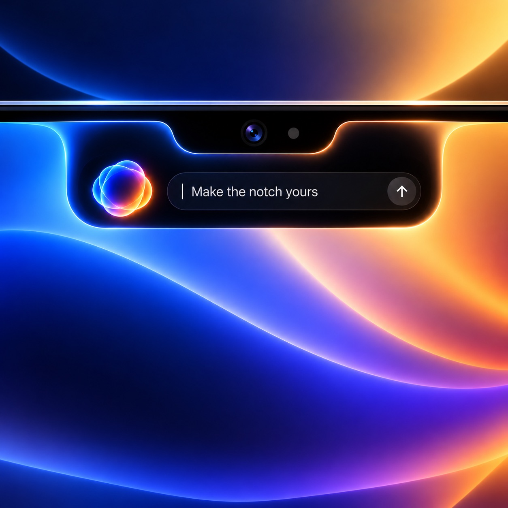
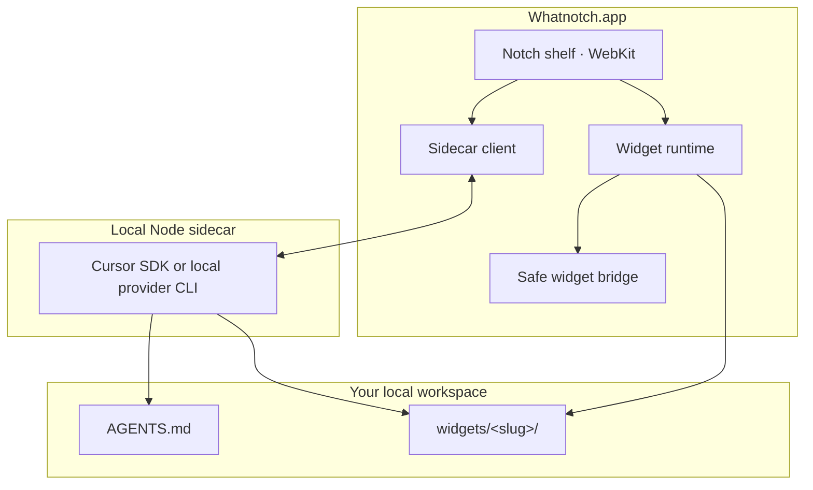

# Whatnotch

<p align="center">
  
</p>

<p align="center">
  <strong>Your coding agent, at the top of your MacBook.</strong><br />
  Build tiny, useful HTML widgets from a shelf that drops out of the notch.
</p>

<p align="center">
  <a href="https://github.com/madeinusmate/whatnotch/stargazers"></a>
  <a href="https://github.com/madeinusmate/whatnotch/issues"></a>
  <a href="./LICENSE"></a>
  
</p>

<p align="center">
  <a href="#getting-started">Getting started</a> ·
  <a href="#what-you-can-build">What you can build</a> ·
  <a href="#how-it-works">How it works</a> ·
  <a href="#contributing">Contributing</a>
</p>

Whatnotch is an open-source, menu-bar–only macOS app for notched MacBooks. It gives your coding agent a natural home in the camera housing: open the shelf, describe a little tool, and get a live widget you can keep close at hand.

Choose Cursor, Claude Code, or Codex. Widgets live in a local workspace and run behind a deliberately small bridge—no direct access to the agent sidecar or its credentials.

> [!NOTE]
> Whatnotch is designed for MacBooks with a camera notch. It needs macOS 14 (Sonoma) or later.

## What you can build

| In the shelf | On the closed notch |
| --- | --- |
|  | **Status at a glance.** A timer, a build state, an event countdown, or another passive, live readout can occupy the space beside the camera housing. |
| **Chat your way to a tool.** Ask for a Pomodoro timer, a status strip, a small dashboard, or a bespoke utility. The agent writes a self-contained widget for you. | **Widgets with a pulse.** An optional Node worker sends state updates to both the shelf card and its compact notch view. |

Every widget is just a small folder:

```text
widgets/my-widget/
├── index.html       # Shelf card (required)
├── manifest.json    # Title and dimensions (optional)
├── worker.mjs       # Background state source (optional)
└── compact.html     # Closed-notch status row (optional)
```

The result is portable, easy to inspect, and easy to modify. You can build widgets with the agent, by hand, or both.

## Highlights

- **Notch-native by design** — a shelf drops from the black camera housing; widgets size to their content and respect Reduced Motion.
- **Cursor-powered** — the bundled Node sidecar talks to the [Cursor Agent SDK](https://www.npmjs.com/package/@cursor/sdk) using a key you add once in Settings.
- **A real local workspace** — each widget gets its own HTML/CSS/JS files under Application Support, not an opaque database.
- **Live compact states** — widgets can show a concise, read-only status on either side of the closed notch.
- **Purposefully narrow bridge** — widget pages can use carefully scoped files, shell commands, and HTTP—not your API key or the sidecar.
- **No Dock clutter** — Whatnotch stays where it belongs: in the menu-bar/notch experience.

## Getting started

### Requirements

| Requirement | Details |
| --- | --- |
| macOS | 14.0+ (Sonoma or later) |
| Hardware | A MacBook with a camera housing notch |
| Xcode | Recent Xcode with the macOS 14 SDK |
| Node.js | 22.13+ available on `PATH` (Homebrew locations are also checked) |
| pnpm | 8.x, used to build the bundled sidecar |
| Cursor | An API key, entered in Whatnotch Settings |
| Claude Code *(optional)* | Installed and signed in (`claude`) |
| Codex / ChatGPT *(optional)* | Codex CLI installed and signed in (bundled with the ChatGPT macOS app when available) |

### Run from source

```bash
git clone https://github.com/madeinusmate/whatnotch.git
cd whatnotch
open Whatnotch.xcodeproj
```

In Xcode, select the **Whatnotch** scheme and press **Run** (`⌘R`). The first build installs the sidecar dependencies, compiles it, and bundles the shelf plus the widget guide into the application.

### Create your first widget

1. Move the pointer to the top of the screen to open the shelf.
2. Open **Settings**, choose Cursor, Claude Code, or Codex (ChatGPT), then complete that provider’s sign-in.
3. Pick a model where available and ask for something useful—for example, _“Make a Pomodoro timer with a compact countdown in the notch.”_

Your local workspace is created at:

```text
~/Library/Application Support/Whatnotch/workspace/
```

Widgets are stored in `workspace/widgets/<slug>/`. The full widget contract is available in [Workspace/AGENTS.md](./Workspace/AGENTS.md).

## How it works



| Piece | Responsibility |
| --- | --- |
| **Shelf** | Chat, settings, sessions, and the widget cards you open. |
| **Sidecar** | A long-lived local Node process that streams provider events and redacts API keys from logs. |
| **Widget runtime** | Watches `widgets/`, runs optional `worker.mjs` files, and distributes live state. |
| **Bridge** | Exposes the constrained `window.notch` API with a scrubbed environment. |

## Widget development

The agent and human contributors use the same widget rules. A shelf page can use the injected bridge like this:

```js
const files = await window.notch.list(".");
const time = await window.notch.shell("date -u +%H:%M");
```

An optional `worker.mjs` can emit newline-delimited state, and `index.html` plus `compact.html` receive it through `notch-state` events. Read the [widget guide](./Workspace/AGENTS.md) before writing a widget; it covers dimensions, compact-notch layout, worker messages, and the bridge’s limits.

## Development

### Build the sidecar

```bash
cd Sidecar
pnpm install
pnpm build
```

Rebuild the **Whatnotch** Xcode scheme after sidecar changes so the post-build phase bundles the new output.

### Regenerate the project (optional)

The checked-in Xcode project is generated from `project.yml`. If you edit that spec, install [XcodeGen](https://github.com/yonaskolb/XcodeGen) and run:

```bash
xcodegen generate
```

## Security and privacy

- Cursor API keys are stored in the macOS Keychain under `app.whatnotch.Whatnotch`; Claude Code and Codex can use their existing local authenticated sessions.
- The Swift host passes a key to the local sidecar only over a private stdin protocol; widget pages never receive it.
- Only `widget://` pages receive `window.notch`.
- The widget bridge allows limited HTTP(S), files, and shell access with a scrubbed environment and output caps.

Please do **not** open public issues for key-handling bugs or sandbox escapes. See [CONTRIBUTING.md](./CONTRIBUTING.md) for the private reporting path.

## Repository map

```text
App/                 Swift macOS app: notch chrome, WebKit, Keychain, widget runtime
Shelf/               Chat shelf HTML, CSS, and JavaScript
Sidecar/             TypeScript Cursor SDK process and host protocol
Workspace/AGENTS.md  Versioned guide copied into each user workspace
tests/               Contract tests for compact-notch behavior
project.yml          XcodeGen project specification
```

## Contributing

Issues, widget ideas, bug reports, documentation improvements, and pull requests are all welcome. For substantial bridge, sandbox, or sidecar protocol changes, please open an issue first so we can align on the design.

Please keep pull requests focused, do not commit API keys or signing identities, and include a screenshot or recording for shelf/notch UI changes when practical. Full details are in [CONTRIBUTING.md](./CONTRIBUTING.md).

## Built with

[Swift](https://www.swift.org/) · [WebKit](https://webkit.org/) · [TypeScript](https://www.typescriptlang.org/) · [Cursor Agent SDK](https://www.npmjs.com/package/@cursor/sdk) · [XcodeGen](https://github.com/yonaskolb/XcodeGen)

## License

Whatnotch is released under the [MIT License](./LICENSE).
