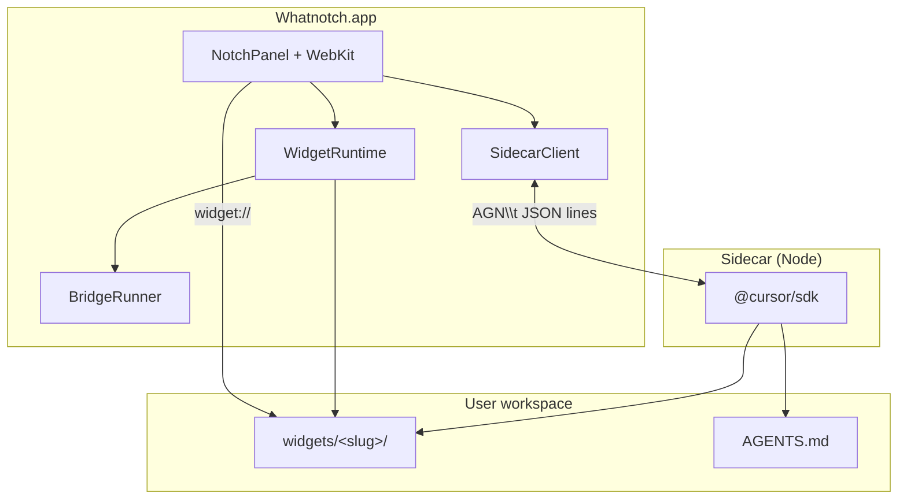

# Whatnotch

**A Cursor agent that lives in your MacBook notch** — chat from the shelf, ship small HTML widgets, and keep live state on the closed notch when you need it.

**Whatnotch** is a menu-bar–style macOS app (no Dock icon) built for Macs with a camera housing notch.

## What it does

- **Notch-native UI** — The shelf drops from the black notch; widgets size to their content and respect reduced motion.
- **Cursor-powered agent** — A Node sidecar talks to the [Cursor Agent SDK](https://www.npmjs.com/package/@cursor/sdk) using your API key (stored in the macOS Keychain, never exposed to widget pages).
- **Widget workspace** — Ask for a timer, a status strip, or a tiny dashboard; the agent creates a folder under your user workspace with `index.html`, optional `worker.mjs`, and optional `compact.html` for the closed notch.
- **Safe widget bridge** — Widgets run in isolated `widget://` pages with a narrow `window.notch` API (shell, files, HTTP). No access to the API key or sidecar.

## Requirements

| | |
| --- | --- |
| **macOS** | 14.0+ (Sonoma or later) |
| **Hardware** | MacBook with a notch (the UI is built around the camera housing) |
| **Node.js** | 22.13+ (`node` on your `PATH` or Homebrew paths the app checks) |
| **pnpm** | 8.x (used by the bundled sidecar build script) |
| **Xcode** | Recent Xcode with the macOS 14 SDK |
| **Cursor** | API key from your Cursor account (entered once in Settings) |

## Quick start

### Run from source

```bash
git clone https://github.com/madeinusmate/whatnotch.git
cd whatnotch
open Whatnotch.xcodeproj
```

In Xcode, select the **Whatnotch** scheme and **Run** (⌘R). The first build installs Sidecar dependencies with `pnpm` and copies `Shelf/`, `Sidecar/dist/`, and `Workspace/AGENTS.md` into the app bundle.

### First launch

1. Move the pointer to the top of the screen to open the shelf (or use the compact notch affordance when a widget is live).
2. Open **Settings** (gear) and paste your **Cursor API key**.
3. Pick a model, then describe a widget — for example, “a pomodoro timer with a compact countdown on the notch.”

Your agent workspace lives at:

`~/Library/Application Support/Whatnotch/workspace/`

Widgets are created under `workspace/widgets/<slug>/`. The agent instructions shipped with the app are mirrored in [`Workspace/AGENTS.md`](./Workspace/AGENTS.md).

## Repository layout

```
App/                 Swift macOS app — notch chrome, WebKit shelf, widget runtime, Keychain
Shelf/               Shelf UI (HTML/CSS/JS) loaded in the main web view
Sidecar/             TypeScript process — Cursor SDK, stdin/stdout protocol with the app
Workspace/AGENTS.md  Default agent prompt (copied into the user workspace on first run)
project.yml          XcodeGen spec (optional regen; Whatnotch.xcodeproj is checked in)
```

## Architecture



| Layer | Role |
| --- | --- |
| **Shelf** | Chat, settings, widget shelf, session list |
| **Sidecar** | Long-lived Node process; streams agent events; redacts API keys in logs |
| **Widget runtime** | Watches `widgets/`, runs optional `worker.mjs`, forwards `notch-state` to pages |
| **Bridge** | Implements `window.notch` with a scrubbed environment (`PATH`, `HOME`, `USER`, `TMPDIR`, `LANG`) |

## Building widgets

Each widget is a small web surface plus optional background worker. The agent (and human contributors) should follow [`Workspace/AGENTS.md`](./Workspace/AGENTS.md). In short:

| File | Purpose |
| --- | --- |
| `index.html` | Main card in the shelf |
| `manifest.json` | Optional title and size (`width` / `height` in points) |
| `worker.mjs` | Optional Node worker; emits JSON lines `{ "type": "state", "body": { ... } }` |
| `compact.html` | Optional single-line UI when the notch is closed |
| `compact` in manifest | Optional closed-notch width (168–320 pt) |

Example bridge usage inside a widget page:

```js
const files = await window.notch.list(".");
const out = await window.notch.shell("date -u +%H:%M");
```

Workers and widgets **cannot** read the Cursor API key or call the sidecar directly.

## Developing the app

### Sidecar only

```bash
cd Sidecar
pnpm install
pnpm build
```

### Regenerate the Xcode project (optional)

If you change `project.yml`, install [XcodeGen](https://github.com/yonaskolb/XcodeGen) and run:

```bash
xcodegen generate
```

### Code signing

`project.yml` may reference a local development team for convenience. Before you distribute builds, use your own **Signing & Capabilities** settings in Xcode or adjust `project.yml` for your team.

## Security model

- **API keys** live in the Keychain (`app.whatnotch.Whatnotch`); the sidecar receives the key only over a private stdin protocol from the Swift host.
- **Widget isolation** uses custom URL schemes and message handlers; only `widget://` pages receive `window.notch`.
- **Network and shell** from widgets are intentionally limited — HTTP(S) only, commands run with a minimal environment and output caps.

Report security issues privately (see [CONTRIBUTING](./CONTRIBUTING.md)); do not open public issues for key-handling or sandbox escapes.

## Related

- [Cursor](https://cursor.com) — editor and agent platform this app integrates with
- [`@cursor/sdk`](https://www.npmjs.com/package/@cursor/sdk) — Agent SDK used by the sidecar

[Agent guide](./Workspace/AGENTS.md) · [CONTRIBUTING](./CONTRIBUTING.md) · [MIT](./LICENSE)
